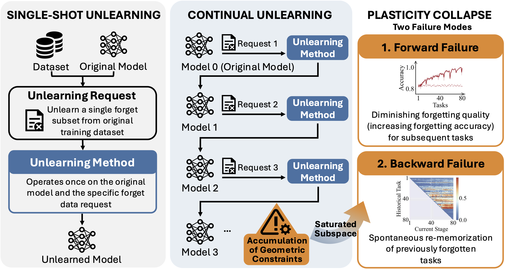

# On the Plasticity Collapse in Continual Machine Unlearning


This is the official repository for the paper: [On the Plasticity Collapse in Continual Machine Unlearning]().
The repository will be continuously maintained. Code and experimental results for both diffusion models and MLLMs will be released in the future.

##  News 
- [x] [2026.06] 👏👏 Accepted to [**ECCV 2026**]()


## Abstract

Machine unlearning enables deep neural networks to selectively remove the influence of specific data in response to privacy and regulatory requirements. While prior work largely studies single-shot unlearning, real-world systems must accommodate continual unlearning, where multiple unlearning requests occur sequentially over time. In this work, we identify a fundamental limitation of this setting: plasticity collapse, a progressive breakdown in a model's ability to effectively forget. Through theoretical analysis of continual unlearning dynamics, we show that continual unlearning operations accumulate geometric constraints in parameter space, leading to saturated subspaces that restrict future updates. This structural effect induces two distinct failure modes: (1) Forward failure -- diminishing forgetting quality for subsequent tasks, and (2) Backward failure -- spontaneous re-memorization of previously forgotten information. Extensive experiments across multiple architectures, datasets, and methods in image classification confirm that plasticity collapse is not an artifact of specific implementations, but a pervasive phenomenon inherent to continual unlearning. Our findings reveal a critical barrier to the long-term reliability of machine unlearning systems and motivate the development of plasticity-preserving unlearning algorithms.


## How to Cite

```
@article{shi2026pcu,
  title={On the Plasticity Collapse in Continual Machine Unlearning},
  author={Shi, Yingdan and Xu, Xiang and Ding, Kaize and Hero, Alfred O. and Wang, Ren},
  booktitle={European Conference on Computer Vision},
  year={2026}
}
```


